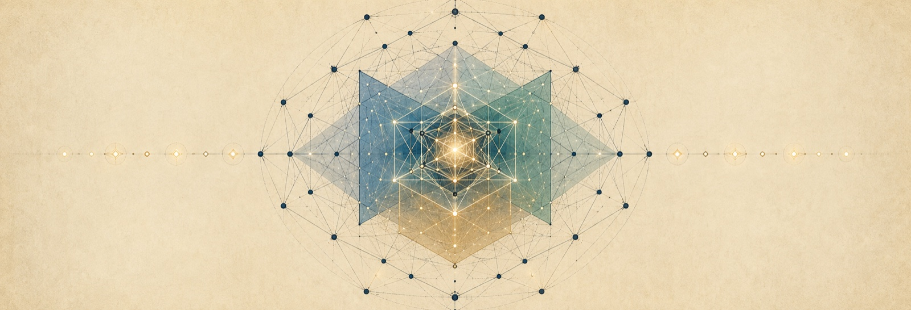

# From Chirality to the Standard Model

  <strong>A uniqueness and no-go theorem for compact homogeneous chiral matter</strong> 
  <em>What if chirality fixed the structure of matter?</em>

  
  
  
  

  

## What if handedness fixed the structure?

In 1957, [Wu and collaborators](https://doi.org/10.1103/PhysRev.105.1413) showed that the weak interaction distinguishes left from right. The Standard Model encodes this handedness through different electroweak representations for left- and right-chiral matter.

Conventionally, one chooses a gauge algebra, a matter representation and its multiplicity, then asks whether the anomalies cancel. Here the question is reversed: can an irreducible homogeneous origin and cubic-anomaly consistency determine those choices together?

For a connected compact pair $H\subset G$ with $H$ closed and $G/H$ infinitesimally effective, require the real isotropy module $q=\mathfrak{g}/\mathfrak{h}$ to be irreducible of complex type,

$$
\mathrm{End}_{\mathfrak{h}}(q)\cong\mathbb{C},
\qquad q_{\mathbb{C}}=V\oplus V^{\ast},
\qquad V\not\cong V^{\ast},
$$

and its cubic trace tensor to have a nonzero ideal-valued radical. Exactly one pair survives, up to duality:

$$
\mathfrak{e}_8\supset\mathfrak{e}_6\oplus\mathfrak{su}(3)_M,
\qquad V=\mathbf{27}\boxtimes\mathbf{3},
\qquad \mathrm{Rad}(c_V)=\mathfrak{e}_6.
$$

This is a **uniqueness and no-go theorem over the stated domain**. The domain fixes no exceptional group, rank, representation dimension or family number in advance.

## Follow the argument

1. **Classify the homogeneous pairs.** Structural reduction and exhaustive full-rank and rank-deficient exclusions leave the displayed exceptional pair.
2. **Resolve its subgroup geometry.** Inside $E_6$, the complete space of $27\cdot36\cdot40=38{,}880$ maximal-subsystem triples has six Weyl orbits. In every triple, one pairwise derived group has strictly greatest dimension. Using that group in the pair-first construction gives the faithful Standard Model and left-right chains on the two extremal orbits. Its chiral dimensions, 15 or 16, follow from restriction.
3. **Read off the chiral content.** Restricting $\mathbf{27}\boxtimes\mathbf{3}$ gives chiral index $\pm3$, alongside vectorlike pairs and singlets. The paper's complete-matter interpretation **(M)** identifies the index with the physical family count.

The [paper](paper/paper.pdf) gives the proofs. The [master notebook](Cubic_Anomaly_Master_Verification.ipynb) walks through the exact calculations and can run the Lean checks.

## Run the notebook

Open it in **Colab** and choose **Runtime → Run all**, or open it in Jupyter from a local checkout. Python verification uses only the standard library.

While the repository is private, download its ZIP from **Code → Download ZIP**, upload the notebook to Colab, and upload the ZIP when the setup cell asks. The same route works for collaborators without putting a GitHub token in the notebook. The Colab button also works when your account can open the private notebook.

The optional Lean section has a **Run Lean** switch and a separate installation switch. Lean checks the exceptional toral census, the Cartan cubic selector, the finite $E_6$ incidence claims and the intrinsic pair ordering. It uses the pinned Lean 4 / Mathlib versions and audits all 25 exported theorems.

| Paper | Exact computation | Lean |
| --- | --- | --- |
| Structural reductions, completeness arguments, invariant theory, global groups and branching | Independent root realizations, complete finite censuses, subgroup kernels and chiral dimensions | Exceptional root-data census, Cartan cubic selector, finite $E_6$ incidence and rank-plus-root-count ordering |

See [verification notes](verification/README.md) for individual commands and the precise Lean scope and trust model.

## Challenge the mathematics

Use the [independent-review prompt](docs/INDEPENDENT_MATH_AUDIT.md) with the complete repository. The buttons below open model sessions; ChatGPT and Grok receive a short prefilled request. For the others, paste the prompt. Attach the ZIP if the model cannot access the private repository.

  <a href="https://chatgpt.com/?q=Independently%20review%20From%20Chirality%20to%20the%20Standard%20Model%20at%20https%3A%2F%2Fgithub.com%2Femad-ii%2Fchirality-standard-model.%20Read%20the%20full%20paper%20and%20inspect%20the%20notebook%2C%20exact%20Python%20checks%20and%20Lean%20proofs.%20Seek%20counterexamples%2C%20omitted%20cases%2C%20unjustified%20implications%20and%20circular%20verification.%20Distinguish%20manuscript%20proofs%2C%20computations%2C%20Lean%20theorems%20and%20the%20stated%20physical%20interpretation.%20Give%20concrete%20findings%20with%20exact%20locations%20and%20reasoning.%20Record%20which%20version%20you%20examined%20and%20what%20you%20actually%20ran.%20If%20you%20cannot%20access%20the%20private%20repository%2C%20ask%20me%20to%20upload%20its%20ZIP.%20Do%20not%20infer%20mathematical%20errors%20from%20unavailable%20tools."></a>
  
  
  <a href="https://grok.com/?q=Independently%20review%20From%20Chirality%20to%20the%20Standard%20Model%20at%20https%3A%2F%2Fgithub.com%2Femad-ii%2Fchirality-standard-model.%20Read%20the%20full%20paper%20and%20inspect%20the%20notebook%2C%20exact%20Python%20checks%20and%20Lean%20proofs.%20Seek%20counterexamples%2C%20omitted%20cases%2C%20unjustified%20implications%20and%20circular%20verification.%20Distinguish%20manuscript%20proofs%2C%20computations%2C%20Lean%20theorems%20and%20the%20stated%20physical%20interpretation.%20Give%20concrete%20findings%20with%20exact%20locations%20and%20reasoning.%20Record%20which%20version%20you%20examined%20and%20what%20you%20actually%20ran.%20If%20you%20cannot%20access%20the%20private%20repository%2C%20ask%20me%20to%20upload%20its%20ZIP.%20Do%20not%20infer%20mathematical%20errors%20from%20unavailable%20tools."></a>
  
  

Concrete objections with exact locations are useful. Model agreement is supplementary review, not a substitute for proof.

---

**Emad Mostaque · September 2026**

[Cite the work](CITATION.cff) · [Review permissions](LICENSE.md)
