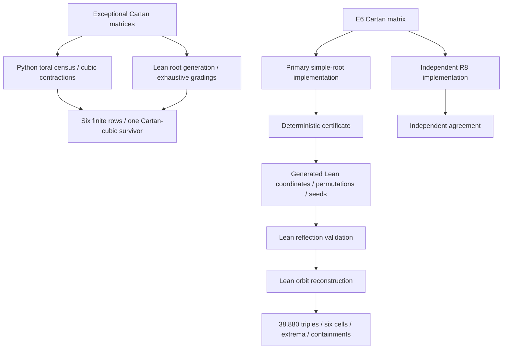

# Paper / Code / Lean Crosswalk

The root-level [master verification notebook](../Cubic_Anomaly_Master_Verification.ipynb)
is the guided tour through this table. It reconstructs the finite objects,
runs both independent incidence routes, validates the certificate, and then
runs the complete Python gate.
The table below records the authority carried by each surface.

| Paper surface | Executable evidence | Lean surface | Current authority |
| --- | --- | --- | --- |
| Section 2: homogeneous domain and cubic radical | `check_proof_and_kernels.py` checks downstream kernel arithmetic | None | Manuscript proof |
| Section 3: direct full-rank exceptional census | `check_toral_gradings.py`; `check_order_three_gradings.py` | `exceptional_toral_census`; `exceptional_order_two_odd_graphs_connected` | Manuscript bridge + Lean-checked finite census + independent exact computation |
| Section 3: cubic coefficients and radical selector | `check_cubic_radical_selection.py` derives the Cartan trace cubic without importing the paper's table | `cartan_cubic_selector` | Manuscript invariant-theory bridge + Lean-checked finite selector + independent exact computation |
| Section 3: exceptional rank-deficient no-go | `check_rank_deficient_exceptional.py`; deterministic exceptional audit JSON | None | Manuscript proof + exact finite sieve |
| Section 3: classical rank-deficient no-go | `check_rank_deficient_classical.py` | None | Manuscript all-rank highest-weight proof + bounded formula regressions + symbolic odd $D$ inequalities |
| Proposition 4.1: three maximal proper closed-subsystem orbits | two closed-subsystem censuses | `subsystem_orbit_types_and_sizes_valid` checks closedness and component root-count/rank signatures on the selected orbit witnesses | Lean for witness-orbit signatures, with standard ADE classification supplying the type names; Python for the complete 5,079 census; manuscript for the orbit classification argument |
| Theorem 4.2: pairwise extrema | two $E_6$ incidence implementations for bounds, count, and extremal transitivity; primary implementation for multiplicities | `extrema_counts_and_bounds_valid` checks the numerical bounds and count; `pairwise_common_multiplicity_valid` checks 720 common masks of multiplicity 6 | Bounds and extremal count: L, C2; common-subsystem multiplicities: L, C1; equality characterization, conventional root-type labels, and stabilizer/coset statements: manuscript proof with exact computational corroboration |
| Theorem 4.3: largest common intersection | two $E_6$ incidence implementations for bound, count, and extremal transitivity; primary implementation for multiplicities | `extrema_counts_and_bounds_valid` checks the numerical bound and count; `common_maximal_multiplicity_valid` checks 1,080 common masks of multiplicity 2 | Bound and extremal count: L, C2; common-subsystem multiplicities: L, C1; equality characterization, conventional root-type labels, and stabilizer/coset statements: manuscript proof with exact computational corroboration |
| Triple universe and six-cell classification / Table 2 | both incidence routes enumerate the triple universe; the primary implementation and certificate generator establish the full six-cell distribution and orbit classification | `triple_space_has_38880_distinct_elements`; `six_cell_distribution_valid`; `six_weyl_orbits_partition_triple_space`; `six_cell_orbits_classified_valid` | Triple-universe count: L, C2; full six-cell distribution and orbit classification: L, C1 |
| Color-containing orbit and connected-group criterion | both incidence routes | `a2_occurs_exactly_on_two_extremal_cells` checks a closed irreducible six-root, rank-two component | Lean + independent computation for the root-system criterion; manuscript proof for the passage to the connected group and its simple $\mathfrak{su}(3)$ factor |
| Context and nested subgroup-root incidences | primary implementation and context checker | `context_counts_valid`; `labelled_containments_valid` | Lean + exact computation at root-system level |
| Global $\mathbb Z_6/\mathbb Z_2$ kernels and LR-to-PS covering kernel | `check_proof_and_kernels.py` | None | Manuscript group argument + exact arithmetic audit |
| Pair-first chiral dimensions | `check_e6_pair_orderings.py` | None | Manuscript branching and minuscule-restriction proof + domain-checked exact computation |
| Section 5 branching and net chirality | exact arithmetic checks | None | Unconditional manuscript branching and chiral-index proof; interpretation (M) enters only at the family-count reading |

## Finite data path

## Source-of-truth rule

- Narrative theorem statements and hypotheses: the paper.
- Finite exceptional census values: Lean reconstruction from the five Cartan matrices, cross-checked by exact Python.
- Finite $E_6$ incidence theorem values: Lean claims, backed by regenerated certificate data.
- Broader finite and arithmetic audits: the Python suite.
- Proof allocation and trust model: `docs/FORMALIZATION_BOUNDARY.md`.

If these surfaces disagree, the release is blocked until the discrepancy is resolved, all four content jobs pass, the hosted release-identity check passes, and the final `release-gate` succeeds.
